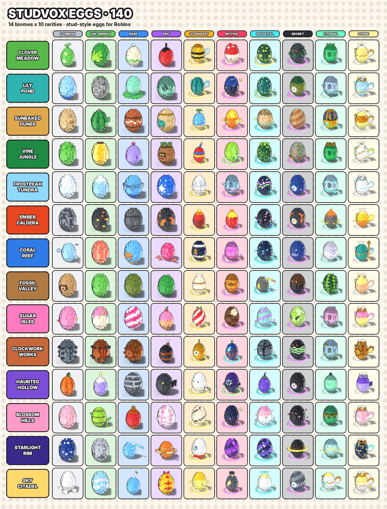
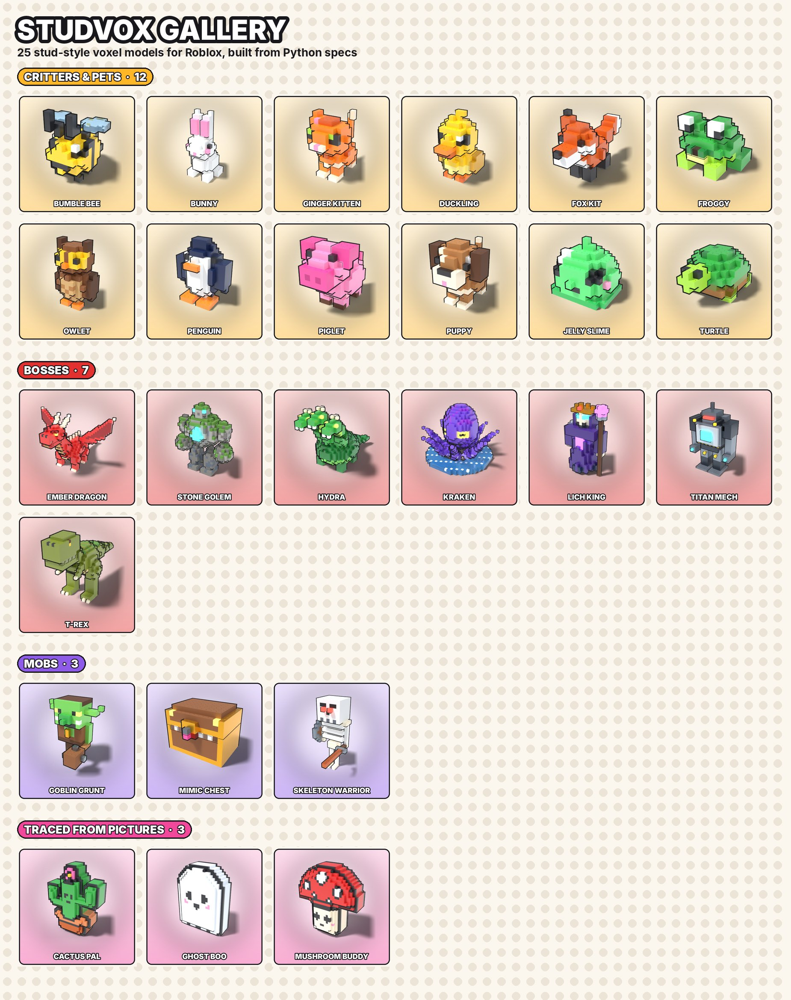

# StudVox: stud-style voxel models for Roblox

Make **brick / stud-style voxel models for Roblox** just by asking Claude Code. It writes the model as a
small Python spec, builds it in Blender (flat studs, black outline, rig, animation clips), renders previews
and a concept sheet, and exports it ready for Studio, including a drag-and-drop `.rbxmx` built from
Roblox's own **Studs** surfaces.

> 🇮🇹 **Uova:** 140 uova originali in 14 biomi × 10 rarità, con configurazione di gioco Luau. Vedi
> [docs/UOVA.md](docs/UOVA.md) e la ricerca su Steal an Egg in
> [docs/RICERCA_STEAL_AN_EGG.md](docs/RICERCA_STEAL_AN_EGG.md).



## What's included

* **140 collectible eggs** for steal/hatch games: 14 themed biomes × 10 rarities, with rarity effects
  (aura ring, sparkles, halos, wings), idle wobble + hatch-shake clips, Silver/Golden/Rainbow/Diamond
  mutations, and a generated `EggConfig` (spawn chances, weights in kg, hatch timers, income). One file:
  [`out/eggs/EggPack.rbxmx`](out/eggs/EggPack.rbxmx). See [docs/UOVA.md](docs/UOVA.md).
* **25 example models** with concept sheets and previews ([gallery](docs/GALLERY.md)):
  * 🐤 12 critters and pets, rigged with idle / walk / action clips: duckling, kitten, puppy, bunny, frog,
    penguin, fox, owl, piglet, slime, bee, turtle
  * 🐉 7 bosses: dragon, kraken, hydra, T-rex, mech, lich, golem
  * 👾 3 mobs: mimic chest, skeleton warrior, goblin
  * 🖼️ 3 models traced from reference pictures, black outline included
* **Blender build + export** script: studs, outline, armature, actions, Cycles renders, FBX / GLB / OBJ.
* **Roblox Luau**: `StudVoxelBuilder` (build models at runtime from data), `StudVoxelAnimator` (play the clips
  on Motor6Ds, nothing to upload), plus the egg modules `EggConfig`, `EggMutations`, `EggBillboard` and an
  `EggSpawner` example.
* **Claude Code integration**: [CLAUDE.md](CLAUDE.md) and the skills in [.claude/skills](.claude/skills)
  teach Claude the whole workflow, so a request like *"make me a mossy turtle pet with a walk cycle"* or
  *"add a Mythic ice egg to the tundra"* turns into a spec, a render it checks, and Studio-ready files.

The same API also covers buildings, props and nature, modular terrain tiles (`Model.tile`) and weapons
exported as Roblox Tools with a grip (`Model.grip`). Ask Claude for those and it will build them.



## Quick start

```bash
pip install -r requirements.txt          # numpy + pillow
bash scripts/setup.sh                    # finds Blender, or installs the bpy module into .venv-bpy
python -m studvox doctor                 # checks the toolchain
python -m studvox make duck              # bake → Roblox files → Blender render/export → concept sheet
python -m studvox make models/eggs --hero-only && python -m studvox eggpack   # rebuild all eggs + EggPack
```

Outputs land in `out/<category>/<name>/`: `<name>.rbxmx`, `<name>.luau`, `sheet.jpg`, `preview.jpg`,
`stats.json` and, when exporting, `<name>.fbx`, `<name>.glb`, `<name>.obj` plus `anims/<name>_<clip>.fbx`.

### Commands

| Command | What it does |
|---|---|
| `python -m studvox make <spec\|dir\|name\|all>` | full pipeline; `--quick` for fast iteration, `--hero-only`, `--no-export`, `--gif`, `--blend` |
| `python -m studvox bake <spec>` | bake only and print sizes / part counts (no Blender) |
| `python -m studvox trace picture.png --name thing` | trace a reference picture into a voxel model spec, then build it |
| `python -m studvox eggpack` | `EggConfig.luau`, `EggPack.rbxmx`, egg catalogue and mutation showcase |
| `python -m studvox gallery` | rebuild `docs/gallery.jpg` and `docs/GALLERY.md` |
| `python -m studvox doctor` | find Blender and check dependencies |

## How a model is written

```python
from studvox import Model
from studvox.kit import face, idle_breathe, walk_quad

def build() -> Model:
    m = Model("cat", title="Ginger Kitten", category="critters")        # 0.25 studs per voxel
    body = m.part("body", pivot=(0, 4, 0))
    body.ellipsoid((0, 4, -1), (3.2, 2.5, 4.3), "orange")
    head = m.part("head", parent="body", pivot=(0, 6, 2))
    head.ellipsoid((0, 9, 2), (3.9, 3.1, 3.1), "orange")
    face(head, "cute", y=10)                                             # ASCII-art decal on the front
    leg = m.part("leg_fl", parent="body", pivot=(2, 2.5, 2))
    leg.box((1, 0, 1), (2, 2, 2), "orange")
    m.mirror_part("leg_fl", "leg_fr")
    ...
    idle_breathe(m)
    walk_quad(m)
    return m
```

Author space is **+X right, +Y up, +Z front**. Parts are rig bones with a pivot; clips move them with
oscillators (`osc`), holds, spins and eased keyframes, baked at 24 fps for every exporter.
See [docs/API.md](docs/API.md) for the full API.

## Studs: Roblox's native surfaces, no bulky cylinders

* In the `.rbxmx` (and with `StudVoxelBuilder`) every brick is a **Plastic** Part with
  `TopSurface = Studs` and `BottomSurface = Inlet` (or `Universal` on top). Roblox only draws these surface
  textures on Plastic, and draws one stud per stud of world size, so at **1 voxel = 1 stud** (eggs, bosses,
  buildings, terrain) every voxel shows exactly one stud.
* Smaller voxels (pets 0.25, weapons 0.125) can use the `texture` stud mode: upload
  `roblox/assets/stud_tile.png` once and set `STUDVOX_STUD_TEXTURE=rbxassetid://<id>` (or
  `model.roblox["stud_texture"]`). Without it they fall back to the native surface.
* Renders and FBX/GLB/OBJ use flat studs too: bump-shaded in Blender, and baked into the texture atlas for
  meshes.

## Importing into Roblox Studio

1. **`.rbxmx` (recommended):** drag it into Studio. Animated models are a `Root` part + one joint per rig part
   joined by Motor6Ds; the included `Animate` script (RunContext Client) plays the clip named in the `Clip`
   StringValue, which you can change from the server. Static models are anchored bricks; weapons are `Tool`s.
2. **Runtime:** put `<name>.luau` and `roblox/StudVoxelBuilder.luau` in ReplicatedStorage and call
   `StudVoxelBuilder.Build(require(data), {parent = workspace})`; animate with `StudVoxelAnimator`.
3. **Meshes:** import `<name>.fbx` with the 3D Importer (Scale Unit: Stud). It brings the rig, the skinned
   meshes split under 10k tris, and the outline shells. Per-clip FBX files are in `anims/`.

## Repository layout

```
studvox/            Python package: model API, shapes, kit helpers, eggs, mesher, Roblox exporters,
                    concept sheets, tracing, gallery, CLI
blender/            studvox_blender.py: build, render, export inside Blender
roblox/             StudVoxelBuilder.luau, StudVoxelAnimator.luau, assets/stud_tile.png
roblox/eggs/        EggConfig (generated), EggMutations, EggBillboard, EggSpawner, EggClientEffects
models/             model specs: critters, bosses, mobs, traced, eggs/<biome>/
references/         reference pictures used by the traced models
out/                generated: Studio files, sheets, previews (renders and mesh exports are git-ignored)
docs/               gallery, egg catalogue, research notes, API
```

Fonts: Inter (SIL Open Font License, see `studvox/fonts/OFL.txt`).
