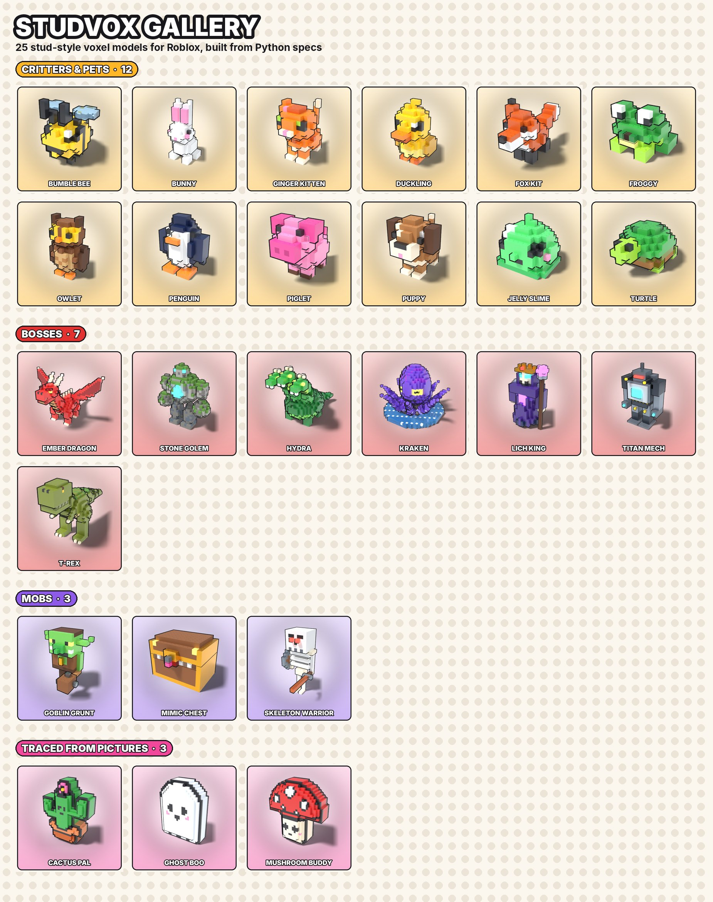

# Gallery

25 example models. Click a name for its concept sheet.
The 140 eggs have their own catalogue: [UOVA.md](UOVA.md).

## Critters & pets

| Model | Size (studs) | Rig | Spec | Studio file |
|---|---|---|---|---|
| [Bumble Bee](../out/critters/bee/sheet.jpg) | 2.75 x 3 x 2.75 | idle, walk, sting | [bee.py](../models/critters/bee.py) | [bee.rbxmx](../out/critters/bee/bee.rbxmx) |
| [Bunny](../out/critters/bunny/sheet.jpg) | 2.25 x 4.75 x 2.5 | idle, walk, happy | [bunny.py](../models/critters/bunny.py) | [bunny.rbxmx](../out/critters/bunny/bunny.rbxmx) |
| [Ginger Kitten](../out/critters/cat/sheet.jpg) | 2.25 x 3.5 x 3.5 | idle, walk, pounce | [cat.py](../models/critters/cat.py) | [cat.rbxmx](../out/critters/cat/cat.rbxmx) |
| [Duckling](../out/critters/duck/sheet.jpg) | 2.25 x 3.75 x 3.25 | idle, walk, quack | [duck.py](../models/critters/duck.py) | [duck.rbxmx](../out/critters/duck/duck.rbxmx) |
| [Fox Kit](../out/critters/fox/sheet.jpg) | 1.75 x 3.5 x 5.5 | idle, walk, leap | [fox.py](../models/critters/fox.py) | [fox.rbxmx](../out/critters/fox/fox.rbxmx) |
| [Froggy](../out/critters/frog/sheet.jpg) | 2.75 x 2 x 2.25 | idle, walk, snap | [frog.py](../models/critters/frog.py) | [frog.rbxmx](../out/critters/frog/frog.rbxmx) |
| [Owlet](../out/critters/owl/sheet.jpg) | 2.25 x 3.75 x 2 | idle, walk, flap | [owl.py](../models/critters/owl.py) | [owl.rbxmx](../out/critters/owl/owl.rbxmx) |
| [Penguin](../out/critters/penguin/sheet.jpg) | 2.75 x 3.25 x 2 | idle, walk, slide | [penguin.py](../models/critters/penguin.py) | [penguin.rbxmx](../out/critters/penguin/penguin.rbxmx) |
| [Piglet](../out/critters/piglet/sheet.jpg) | 2.25 x 3 x 3.5 | idle, walk, roll | [piglet.py](../models/critters/piglet.py) | [piglet.rbxmx](../out/critters/piglet/piglet.rbxmx) |
| [Puppy](../out/critters/puppy/sheet.jpg) | 2.75 x 3.25 x 3.25 | idle, walk, bark | [puppy.py](../models/critters/puppy.py) | [puppy.rbxmx](../out/critters/puppy/puppy.rbxmx) |
| [Jelly Slime](../out/critters/slime/sheet.jpg) | 2.75 x 2.5 x 2.75 | idle, walk, splat | [slime.py](../models/critters/slime.py) | [slime.rbxmx](../out/critters/slime/slime.rbxmx) |
| [Turtle](../out/critters/turtle/sheet.jpg) | 2.25 x 1.75 x 3.75 | idle, walk, hide | [turtle.py](../models/critters/turtle.py) | [turtle.rbxmx](../out/critters/turtle/turtle.rbxmx) |

## Bosses

| Model | Size (studs) | Rig | Spec | Studio file |
|---|---|---|---|---|
| [Ember Dragon](../out/bosses/dragon/sheet.jpg) | 45 x 32 x 53 | idle, walk, roar | [dragon.py](../models/bosses/dragon.py) | [dragon.rbxmx](../out/bosses/dragon/dragon.rbxmx) |
| [Stone Golem](../out/bosses/golem/sheet.jpg) | 25 x 28 x 10 | idle, walk, pound | [golem.py](../models/bosses/golem.py) | [golem.rbxmx](../out/bosses/golem/golem.rbxmx) |
| [Hydra](../out/bosses/hydra/sheet.jpg) | 17 x 28 x 39 | idle, walk, bite | [hydra.py](../models/bosses/hydra.py) | [hydra.rbxmx](../out/bosses/hydra/hydra.rbxmx) |
| [Kraken](../out/bosses/kraken/sheet.jpg) | 33 x 25 x 33 | idle, walk, slam | [kraken.py](../models/bosses/kraken.py) | [kraken.rbxmx](../out/bosses/kraken/kraken.rbxmx) |
| [Lich King](../out/bosses/lich/sheet.jpg) | 16 x 24 x 11 | idle, walk, cast | [lich.py](../models/bosses/lich.py) | [lich.rbxmx](../out/bosses/lich/lich.rbxmx) |
| [Titan Mech](../out/bosses/mech/sheet.jpg) | 21 x 32 x 12 | idle, walk, barrage | [mech.py](../models/bosses/mech.py) | [mech.rbxmx](../out/bosses/mech/mech.rbxmx) |
| [T-Rex](../out/bosses/t_rex/sheet.jpg) | 15 x 28 x 43 | idle, walk, roar | [t_rex.py](../models/bosses/t_rex.py) | [t_rex.rbxmx](../out/bosses/t_rex/t_rex.rbxmx) |

## Mobs

| Model | Size (studs) | Rig | Spec | Studio file |
|---|---|---|---|---|
| [Goblin Grunt](../out/mobs/goblin/sheet.jpg) | 7.5 x 8.5 x 5.5 | idle, walk, smash | [goblin.py](../models/mobs/goblin.py) | [goblin.rbxmx](../out/mobs/goblin/goblin.rbxmx) |
| [Mimic Chest](../out/mobs/mimic_chest/sheet.jpg) | 6.5 x 5 x 5.5 | idle, walk, bite | [mimic_chest.py](../models/mobs/mimic_chest.py) | [mimic_chest.rbxmx](../out/mobs/mimic_chest/mimic_chest.rbxmx) |
| [Skeleton Warrior](../out/mobs/skeleton/sheet.jpg) | 6 x 11 x 7.5 | idle, walk, slash | [skeleton.py](../models/mobs/skeleton.py) | [skeleton.rbxmx](../out/mobs/skeleton/skeleton.rbxmx) |

## Traced from pictures

| Model | Size (studs) | Rig | Spec | Studio file |
|---|---|---|---|---|
| [Cactus Pal](../out/traced/cactus_pal/sheet.jpg) | 6 x 7.5 x 2.75 | idle, hop | [cactus_pal.py](../models/traced/cactus_pal.py) | [cactus_pal.rbxmx](../out/traced/cactus_pal/cactus_pal.rbxmx) |
| [Ghost Boo](../out/traced/ghost_boo/sheet.jpg) | 5.75 x 7.5 x 2.75 | idle, hop | [ghost_boo.py](../models/traced/ghost_boo.py) | [ghost_boo.rbxmx](../out/traced/ghost_boo/ghost_boo.rbxmx) |
| [Mushroom Buddy](../out/traced/mushroom_buddy/sheet.jpg) | 7 x 7.5 x 3.25 | idle, hop | [mushroom_buddy.py](../models/traced/mushroom_buddy.py) | [mushroom_buddy.rbxmx](../out/traced/mushroom_buddy/mushroom_buddy.rbxmx) |
