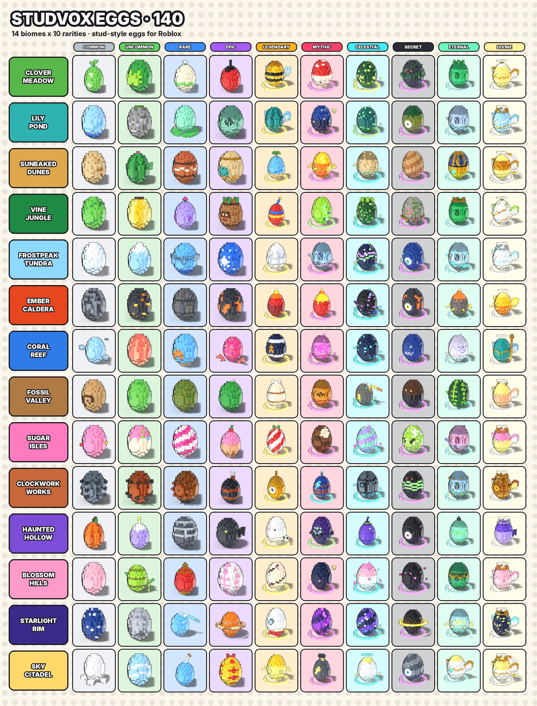

# Le 140 uova StudVox

140 uova originali a mattoncini per giochi Roblox in stile "ruba e schiudi": **14 biomi × 10 rarità**,
ispirate alla *struttura* di Steal an Egg (vedi la [ricerca](RICERCA_STEAL_AN_EGG.md)), con una
configurazione di gioco pronta in Luau.



* Elenco completo con rendite, pesi, probabilità e tempi di schiusa: [eggs/LISTA_UOVA.md](eggs/LISTA_UOVA.md)
* Una tavola per bioma: `docs/eggs/<bioma>.jpg` (ad esempio [meadow](eggs/meadow.jpg) o [sky](eggs/sky.jpg))
* Mutazioni: [eggs/mutations.jpg](eggs/mutations.jpg)

## Biomi

| # | Bioma | Velocità | Tema |
|---|---|---|---|
| 1 | Clover Meadow | 0 | germogli, fiori, coccinelle, funghi |
| 2 | Lily Pond | 1K | ninfee, gocce, gelatine, libellule |
| 3 | Sunbaked Dunes | 7,5K | sabbia, cactus, terracotta, oro egizio |
| 4 | Vine Jungle | 40K | liane, tiki, orchidee, idoli |
| 5 | Frostpeak Tundra | 200K | neve, ghiaccio, aurora, ghiaccioli |
| 6 | Ember Caldera | 1M | cenere, magma, ossidiana, fiamme |
| 7 | Coral Reef | 5M | bolle, conchiglie, coralli, abissi |
| 8 | Fossil Valley | 25M | fossili, ambra, ossa, meteore |
| 9 | Sugar Isles | 125M | caramelle, glassa, cioccolato, zucchero |
| 10 | Clockwork Works | 600M | rame, ingranaggi, vapore, robot |
| 11 | Haunted Hollow | 3B | zucche, candele, fantasmi, maledizioni |
| 12 | Blossom Hills | 15B | sakura, lanterne, bambù, giada |
| 13 | Starlight Rim | 75B | stelle, pianeti, nebulose, buchi neri |
| 14 | Sky Citadel | 400B | nuvole, piume, tuoni, angeli |

## Rarità

| Rarità | Spawn | Schiusa base | Rendita × | Aspetto |
|---|---|---|---|---|
| Common | 38 % | 10 s | 1 | uovo semplice, 15 stud |
| Uncommon | 25 % | 20 s | 1,8 | pattern e piccoli dettagli |
| Rare | 15 % | 40 s | 3,2 | più grande (17 stud), accessorio |
| Epic | 9 % | 75 s | 5,8 | accessori elaborati |
| Legendary | 5,5 % | 2 m | 10,5 | + anello d'aura luminoso a terra |
| Mythic | 3,6 % | 3 m | 19 | crepe/rune luminose, effetti animati |
| Celestial | 2 % | 4,5 m | 34 | 19 stud, scintille o oggetti in orbita |
| Secret | 1 % | 7 m | 61 | scuro e misterioso: occhi che spiano |
| Eternal | 0,6 % | 10 m | 110 | gusci di vetro/cristallo con un nucleo dentro |
| Divine | 0,3 % | 15 m | 200 | 20 stud, aureola e ali |

La rendita base di un uovo è `4 × 5^(bioma-1) × moltiplicatore di rarità` dollari al secondo; il peso base va da 1,2 kg
(Common) a 40 kg (Divine) e cresce del 15 % a ogni bioma. Tutti i numeri sono in `studvox/eggs.py`
(tabelle `RARITIES`, `BIOMES`, `MUTATIONS`) e finiscono in `EggConfig.luau`.

## Usarle in Roblox Studio

1. Trascina **`out/eggs/EggPack.rbxmx`** in Studio e mettilo in `ReplicatedStorage`. Ottieni la cartella
   `StudVoxEggs`, che contiene:
   * `Eggs/<bioma>/<id_uovo>`: le 140 uova, una Model per uovo, chiamata con il suo id (es. `sprout_egg`)
   * `EggConfig`: biomi, rarità, mutazioni e i numeri di ogni uovo, più le funzioni di gioco
   * `EggMutations`: Silver, Golden, Rainbow e Diamond applicate a runtime
   * `EggBillboard`: il cartellino sopra l'uovo (nome, rarità, kg, $/s)
   * `StudVoxelAnimator`: anima le uova (oscillazione, schiusa, aureole, ali)
   * `Examples/EggSpawner` (Script) ed `Examples/EggClientEffects` (LocalScript)
2. Sposta `EggSpawner` in `ServerScriptService` ed `EggClientEffects` in `StarterPlayer > StarterPlayerScripts`.
3. Crea delle Part come piattaforme di spawn: aggiungi il tag **`EggSpawn`** e un attributo stringa **`Biome`**
   con l'id del bioma (`meadow`, `pond`, `dunes`, `jungle`, `tundra`, `caldera`, `reef`, `fossil`, `candy`,
   `clockwork`, `haunted`, `blossom`, `starlight`, `sky`).
4. Premi Play: sulle piattaforme compaiono uova tirate a caso per rarità, con il peso in kg, la mutazione e il
   cartellino.

### Com'è fatto ogni uovo

```
sprout_egg (Model, PrimaryPart = Root, pivot alla base)
  Root           box invisibile ancorato: la "hitbox" dell'uovo
  shell          Model con il giunto shellJoint (Motor6D "shell") e i mattoncini del guscio
  halo / wing_l / wing_r / aura / ...   accessori, ognuno con il suo Motor6D
  Clip           StringValue: "idle" (oscilla) – metti "hatch" per lo scossone di schiusa
  Animate        Script (RunContext Client): anima l'uovo solo quando è dentro workspace
  StudVoxelAnimator, Clips   ModuleScript usati da Animate
```

* I mattoncini sono Part in **Plastic** con `TopSurface = Studs` e `BottomSurface = Inlet`: gli stud li disegna
  Roblox, senza geometria extra. 1 voxel = 1 stud.
* Le uova sono saldate al loro giunto: `Model:ScaleTo()` e `Model:PivotTo()` funzionano come previsto.
  `Root` è ancorato; per portare l'uovo in mano disancoralo e saldalo al personaggio.
* Per far schiudere un uovo, metti `egg.Clip.Value = "hatch"`. Al termine della clip torna da solo su `idle`.

### API di `EggConfig`

| Funzione | Cosa fa |
|---|---|
| `EggConfig.Eggs[id]` | dati dell'uovo: `name`, `biome`, `rarity`, `spawnChance`, `hatchSeconds`, `baseIncome`, `baseWeight`, `modelHeight`, `flavor` |
| `EggConfig.Biomes`, `.BiomeById` | biomi in ordine, con `unlockSpeed`, `color` e la lista `eggs` |
| `EggConfig.Rarities`, `.RarityById` | rarità in ordine, con `color`, `spawnChance` e `incomeMultiplier` |
| `EggConfig.Mutations`, `.MutationById` | `normal`, `silver`, `golden`, `rainbow`, `diamond` con `multiplier` e `chance` |
| `RollEgg(biomeId, rng?)` | quale uovo spawna, pesato per rarità |
| `RollWeight(id, rng?)` | peso in kg (log-normale, 1 % uova enormi) |
| `RollMutation(rng?)` | mutazione alla nascita |
| `Income(id, kg, mutazione)` | soldi al secondo del pet schiuso |
| `HatchSeconds(id, kg)` | durata della schiusa (più lunga per uova pesanti) |
| `ScaleForWeight(id, kg)` | fattore per `Model:ScaleTo()` (un Common normale è alto ~4,5 stud) |
| `CarrySpeedMultiplier(kg)` | moltiplicatore della WalkSpeed mentre lo trasporti |
| `FormatMoney(n)` | `$1.2K`, `$3.4M`, ... |

## Creare nuove uova con Claude Code

Ogni uovo è un piccolo file in `models/eggs/<bioma>/<id>.py` con un `EggDesign`: colori, pattern a strati
e accessori. Basta chiedere a Claude Code, ad esempio:

> «Crea un uovo Mythic per la Frostpeak Tundra: blu ghiaccio con una spirale bianca, cristalli che escono dal guscio e una piccola fiamma blu in cima.»

Claude scrive la spec, poi lancia:

```bash
python -m studvox make models/eggs/tundra/<id>.py --hero-only   # render + .rbxmx
python -m studvox eggpack                                        # rigenera EggConfig, EggPack e catalogo
```

Pattern disponibili: `band`, `bands`, `zigzag`, `wave`, `stripes`, `swirl`, `checker`, `gradient`, `cap`,
`bottom`, `split`, `spots`, `dots`, `speckle`, `cracks`, `drips`, `scales`, `plaid`, `diamonds`, `web`,
`vines`, `panels`, `face`, `art` (pixel art ASCII sul davanti), `material`.

Accessori: `sprout`, `flower`, `leaf_crown`, `crown`, `halo`, `wings`, `bat_wings`, `horns`, `ears`, `flame`,
`candle`, `snowcap`, `icicles`, `spikes`, `ridge`, `gear`, `rivets`, `pipe`, `witch_hat`, `stem`, `lily_pad`,
`bubbles`, `coral`, `fins`, `side_fins`, `planet_ring`, `orbit`, `moon`, `comet_tail`, `antenna`, `big_eye`,
`eyes_peek`, `question`, `gem`, `clouds`, `feather`, `lightning`, `rays`, `petals`, `bamboo`, `bow`,
`gumdrops`, `cherry`, `bite`, `bone`, `fossil`, `inner` (nucleo dentro un guscio di vetro), `crystals`,
`chains`, `skull`, `ghost`, `thunder_cloud`, `aura`, `sparkles`, `tiki`, `cactus_arms`, `palm`, `sun_disk`,
`scarab`, `lantern_ring`, `starfish`, `anchor`, `trident`, `mushroom`, `honey_drip`, `runes`.

Dalla rarità Legendary in su l'uovo riceve in automatico l'anello d'aura; i Celestial ricevono le scintille e i
Divine aureola e ali, se non le hanno già.
