# Lista delle 140 uova

Generata da `python -m studvox eggpack`. Rendita e peso sono i valori base: in gioco il peso
viene tirato a caso allo spawn e la rendita cresce con il peso e la mutazione (vedi `EggConfig.Income`).

## Clover Meadow · velocità 0

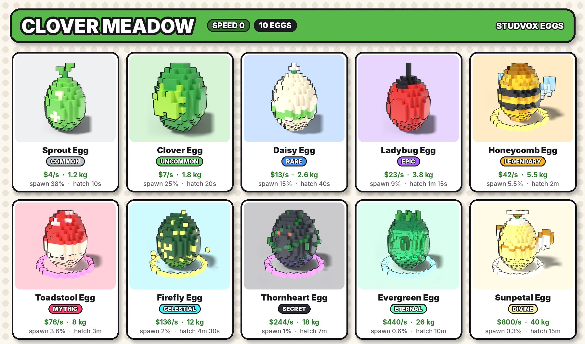

| Uovo | Rarità | Rendita base | Peso base | Spawn | Schiusa | Spec |
|---|---|---|---|---|---|---|
| Sprout Egg | Common | $4/s | 1.2 kg | 38% | 10s | [sprout_egg.py](../../models/eggs/meadow/sprout_egg.py) |
| Clover Egg | Uncommon | $7/s | 1.8 kg | 25% | 20s | [clover_egg.py](../../models/eggs/meadow/clover_egg.py) |
| Daisy Egg | Rare | $13/s | 2.6 kg | 15% | 40s | [daisy_egg.py](../../models/eggs/meadow/daisy_egg.py) |
| Ladybug Egg | Epic | $23/s | 3.8 kg | 9% | 1m 15s | [ladybug_egg.py](../../models/eggs/meadow/ladybug_egg.py) |
| Honeycomb Egg | Legendary | $42/s | 5.5 kg | 5.5% | 2m | [honeycomb_egg.py](../../models/eggs/meadow/honeycomb_egg.py) |
| Toadstool Egg | Mythic | $76/s | 8 kg | 3.6% | 3m | [toadstool_egg.py](../../models/eggs/meadow/toadstool_egg.py) |
| Firefly Egg | Celestial | $136/s | 12 kg | 2% | 4m 30s | [firefly_egg.py](../../models/eggs/meadow/firefly_egg.py) |
| Thornheart Egg | Secret | $244/s | 18 kg | 1% | 7m | [thornheart_egg.py](../../models/eggs/meadow/thornheart_egg.py) |
| Evergreen Egg | Eternal | $440/s | 26 kg | 0.6% | 10m | [evergreen_egg.py](../../models/eggs/meadow/evergreen_egg.py) |
| Sunpetal Egg | Divine | $800/s | 40 kg | 0.3% | 15m | [sunpetal_egg.py](../../models/eggs/meadow/sunpetal_egg.py) |

## Lily Pond · velocità 1K

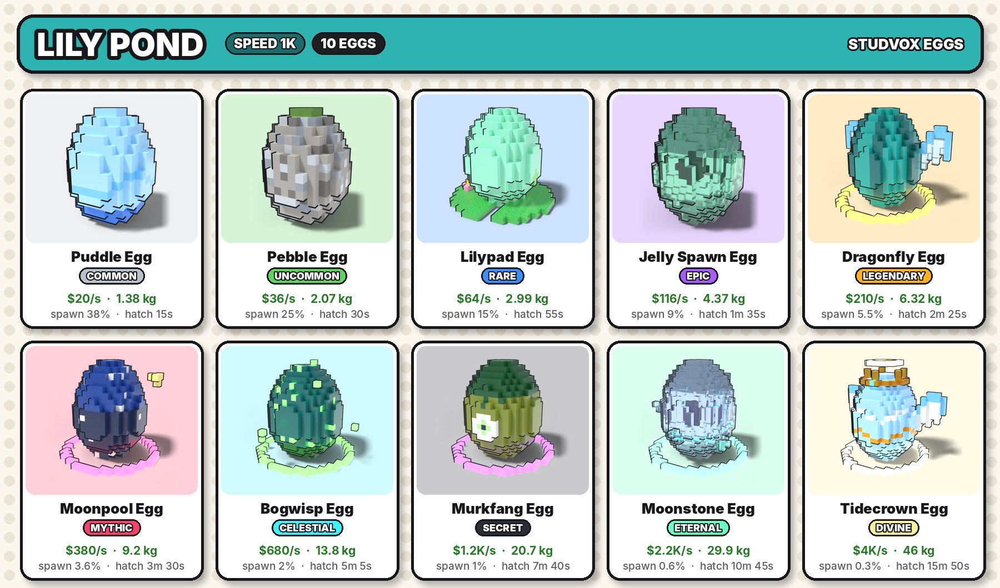

| Uovo | Rarità | Rendita base | Peso base | Spawn | Schiusa | Spec |
|---|---|---|---|---|---|---|
| Puddle Egg | Common | $20/s | 1.38 kg | 38% | 15s | [puddle_egg.py](../../models/eggs/pond/puddle_egg.py) |
| Pebble Egg | Uncommon | $36/s | 2.07 kg | 25% | 30s | [pebble_egg.py](../../models/eggs/pond/pebble_egg.py) |
| Lilypad Egg | Rare | $64/s | 2.99 kg | 15% | 55s | [lilypad_egg.py](../../models/eggs/pond/lilypad_egg.py) |
| Jelly Spawn Egg | Epic | $116/s | 4.37 kg | 9% | 1m 35s | [jelly_spawn_egg.py](../../models/eggs/pond/jelly_spawn_egg.py) |
| Dragonfly Egg | Legendary | $210/s | 6.32 kg | 5.5% | 2m 25s | [dragonfly_egg.py](../../models/eggs/pond/dragonfly_egg.py) |
| Moonpool Egg | Mythic | $380/s | 9.2 kg | 3.6% | 3m 30s | [moonpool_egg.py](../../models/eggs/pond/moonpool_egg.py) |
| Bogwisp Egg | Celestial | $680/s | 13.8 kg | 2% | 5m 5s | [bogwisp_egg.py](../../models/eggs/pond/bogwisp_egg.py) |
| Murkfang Egg | Secret | $1.2K/s | 20.7 kg | 1% | 7m 40s | [murkfang_egg.py](../../models/eggs/pond/murkfang_egg.py) |
| Moonstone Egg | Eternal | $2.2K/s | 29.9 kg | 0.6% | 10m 45s | [moonstone_egg.py](../../models/eggs/pond/moonstone_egg.py) |
| Tidecrown Egg | Divine | $4K/s | 46 kg | 0.3% | 15m 50s | [tidecrown_egg.py](../../models/eggs/pond/tidecrown_egg.py) |

## Sunbaked Dunes · velocità 7.5K

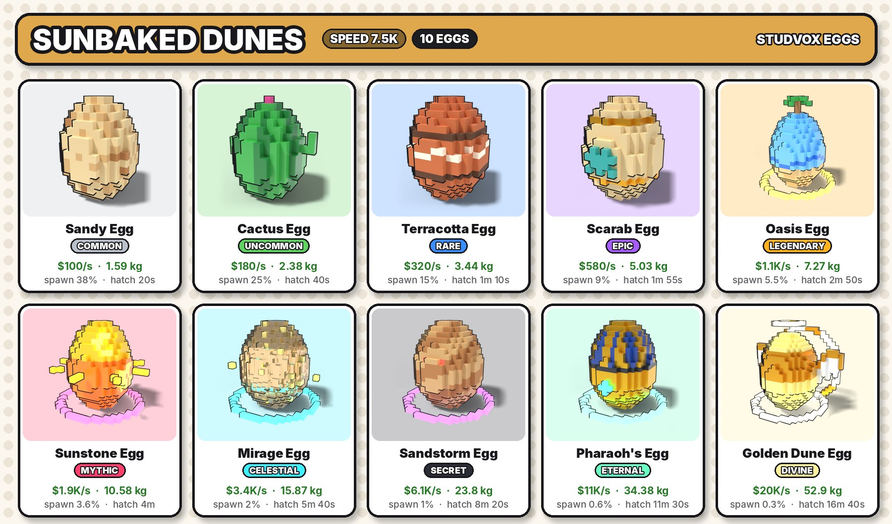

| Uovo | Rarità | Rendita base | Peso base | Spawn | Schiusa | Spec |
|---|---|---|---|---|---|---|
| Sandy Egg | Common | $100/s | 1.59 kg | 38% | 20s | [sandy_egg.py](../../models/eggs/dunes/sandy_egg.py) |
| Cactus Egg | Uncommon | $180/s | 2.38 kg | 25% | 40s | [cactus_egg.py](../../models/eggs/dunes/cactus_egg.py) |
| Terracotta Egg | Rare | $320/s | 3.44 kg | 15% | 1m 10s | [terracotta_egg.py](../../models/eggs/dunes/terracotta_egg.py) |
| Scarab Egg | Epic | $580/s | 5.03 kg | 9% | 1m 55s | [scarab_egg.py](../../models/eggs/dunes/scarab_egg.py) |
| Oasis Egg | Legendary | $1.1K/s | 7.27 kg | 5.5% | 2m 50s | [oasis_egg.py](../../models/eggs/dunes/oasis_egg.py) |
| Sunstone Egg | Mythic | $1.9K/s | 10.58 kg | 3.6% | 4m | [sunstone_egg.py](../../models/eggs/dunes/sunstone_egg.py) |
| Mirage Egg | Celestial | $3.4K/s | 15.87 kg | 2% | 5m 40s | [mirage_egg.py](../../models/eggs/dunes/mirage_egg.py) |
| Sandstorm Egg | Secret | $6.1K/s | 23.8 kg | 1% | 8m 20s | [sandstorm_egg.py](../../models/eggs/dunes/sandstorm_egg.py) |
| Pharaoh's Egg | Eternal | $11K/s | 34.38 kg | 0.6% | 11m 30s | [pharaohs_egg.py](../../models/eggs/dunes/pharaohs_egg.py) |
| Golden Dune Egg | Divine | $20K/s | 52.9 kg | 0.3% | 16m 40s | [golden_dune_egg.py](../../models/eggs/dunes/golden_dune_egg.py) |

## Vine Jungle · velocità 40K

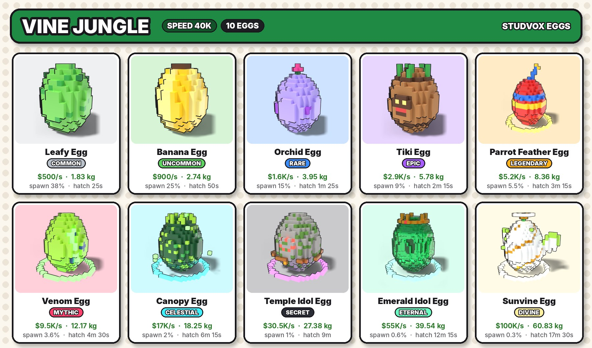

| Uovo | Rarità | Rendita base | Peso base | Spawn | Schiusa | Spec |
|---|---|---|---|---|---|---|
| Leafy Egg | Common | $500/s | 1.83 kg | 38% | 25s | [leafy_egg.py](../../models/eggs/jungle/leafy_egg.py) |
| Banana Egg | Uncommon | $900/s | 2.74 kg | 25% | 50s | [banana_egg.py](../../models/eggs/jungle/banana_egg.py) |
| Orchid Egg | Rare | $1.6K/s | 3.95 kg | 15% | 1m 25s | [orchid_egg.py](../../models/eggs/jungle/orchid_egg.py) |
| Tiki Egg | Epic | $2.9K/s | 5.78 kg | 9% | 2m 15s | [tiki_egg.py](../../models/eggs/jungle/tiki_egg.py) |
| Parrot Feather Egg | Legendary | $5.2K/s | 8.36 kg | 5.5% | 3m 15s | [parrot_feather_egg.py](../../models/eggs/jungle/parrot_feather_egg.py) |
| Venom Egg | Mythic | $9.5K/s | 12.17 kg | 3.6% | 4m 30s | [venom_egg.py](../../models/eggs/jungle/venom_egg.py) |
| Canopy Egg | Celestial | $17K/s | 18.25 kg | 2% | 6m 15s | [canopy_egg.py](../../models/eggs/jungle/canopy_egg.py) |
| Temple Idol Egg | Secret | $30.5K/s | 27.38 kg | 1% | 9m | [temple_idol_egg.py](../../models/eggs/jungle/temple_idol_egg.py) |
| Emerald Idol Egg | Eternal | $55K/s | 39.54 kg | 0.6% | 12m 15s | [emerald_idol_egg.py](../../models/eggs/jungle/emerald_idol_egg.py) |
| Sunvine Egg | Divine | $100K/s | 60.83 kg | 0.3% | 17m 30s | [sunvine_egg.py](../../models/eggs/jungle/sunvine_egg.py) |

## Frostpeak Tundra · velocità 200K

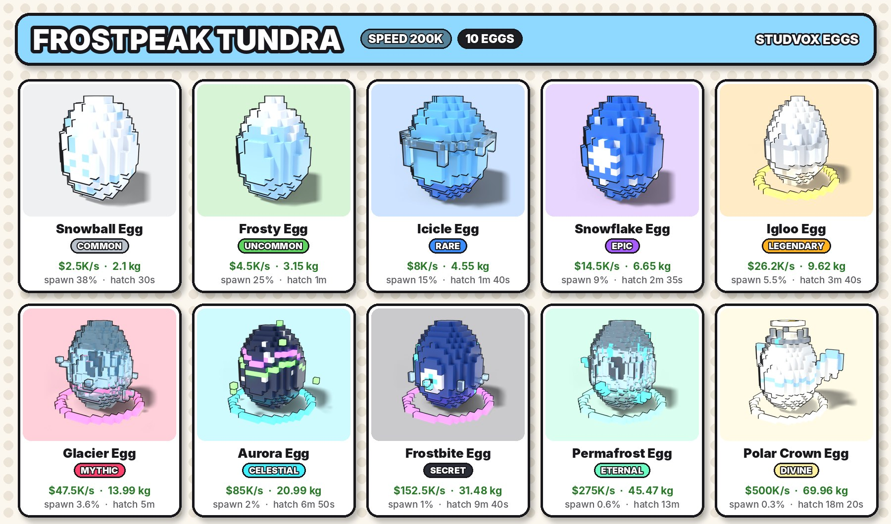

| Uovo | Rarità | Rendita base | Peso base | Spawn | Schiusa | Spec |
|---|---|---|---|---|---|---|
| Snowball Egg | Common | $2.5K/s | 2.1 kg | 38% | 30s | [snowball_egg.py](../../models/eggs/tundra/snowball_egg.py) |
| Frosty Egg | Uncommon | $4.5K/s | 3.15 kg | 25% | 1m | [frosty_egg.py](../../models/eggs/tundra/frosty_egg.py) |
| Icicle Egg | Rare | $8K/s | 4.55 kg | 15% | 1m 40s | [icicle_egg.py](../../models/eggs/tundra/icicle_egg.py) |
| Snowflake Egg | Epic | $14.5K/s | 6.65 kg | 9% | 2m 35s | [snowflake_egg.py](../../models/eggs/tundra/snowflake_egg.py) |
| Igloo Egg | Legendary | $26.2K/s | 9.62 kg | 5.5% | 3m 40s | [igloo_egg.py](../../models/eggs/tundra/igloo_egg.py) |
| Glacier Egg | Mythic | $47.5K/s | 13.99 kg | 3.6% | 5m | [glacier_egg.py](../../models/eggs/tundra/glacier_egg.py) |
| Aurora Egg | Celestial | $85K/s | 20.99 kg | 2% | 6m 50s | [aurora_egg.py](../../models/eggs/tundra/aurora_egg.py) |
| Frostbite Egg | Secret | $152.5K/s | 31.48 kg | 1% | 9m 40s | [frostbite_egg.py](../../models/eggs/tundra/frostbite_egg.py) |
| Permafrost Egg | Eternal | $275K/s | 45.47 kg | 0.6% | 13m | [permafrost_egg.py](../../models/eggs/tundra/permafrost_egg.py) |
| Polar Crown Egg | Divine | $500K/s | 69.96 kg | 0.3% | 18m 20s | [polar_crown_egg.py](../../models/eggs/tundra/polar_crown_egg.py) |

## Ember Caldera · velocità 1M

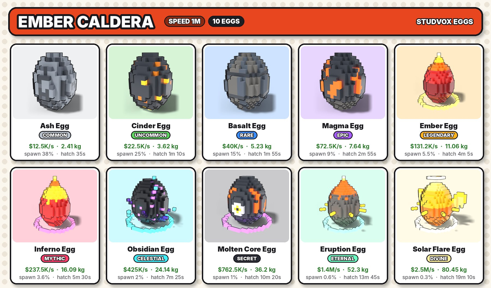

| Uovo | Rarità | Rendita base | Peso base | Spawn | Schiusa | Spec |
|---|---|---|---|---|---|---|
| Ash Egg | Common | $12.5K/s | 2.41 kg | 38% | 35s | [ash_egg.py](../../models/eggs/caldera/ash_egg.py) |
| Cinder Egg | Uncommon | $22.5K/s | 3.62 kg | 25% | 1m 10s | [cinder_egg.py](../../models/eggs/caldera/cinder_egg.py) |
| Basalt Egg | Rare | $40K/s | 5.23 kg | 15% | 1m 55s | [basalt_egg.py](../../models/eggs/caldera/basalt_egg.py) |
| Magma Egg | Epic | $72.5K/s | 7.64 kg | 9% | 2m 55s | [magma_egg.py](../../models/eggs/caldera/magma_egg.py) |
| Ember Egg | Legendary | $131.2K/s | 11.06 kg | 5.5% | 4m 5s | [ember_egg.py](../../models/eggs/caldera/ember_egg.py) |
| Inferno Egg | Mythic | $237.5K/s | 16.09 kg | 3.6% | 5m 30s | [inferno_egg.py](../../models/eggs/caldera/inferno_egg.py) |
| Obsidian Egg | Celestial | $425K/s | 24.14 kg | 2% | 7m 25s | [obsidian_egg.py](../../models/eggs/caldera/obsidian_egg.py) |
| Molten Core Egg | Secret | $762.5K/s | 36.2 kg | 1% | 10m 20s | [molten_core_egg.py](../../models/eggs/caldera/molten_core_egg.py) |
| Eruption Egg | Eternal | $1.4M/s | 52.3 kg | 0.6% | 13m 45s | [eruption_egg.py](../../models/eggs/caldera/eruption_egg.py) |
| Solar Flare Egg | Divine | $2.5M/s | 80.45 kg | 0.3% | 19m 10s | [solar_flare_egg.py](../../models/eggs/caldera/solar_flare_egg.py) |

## Coral Reef · velocità 5M

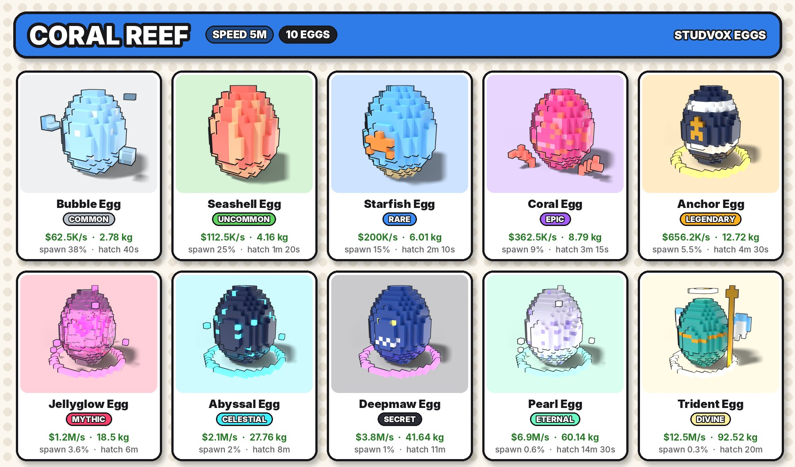

| Uovo | Rarità | Rendita base | Peso base | Spawn | Schiusa | Spec |
|---|---|---|---|---|---|---|
| Bubble Egg | Common | $62.5K/s | 2.78 kg | 38% | 40s | [bubble_egg.py](../../models/eggs/reef/bubble_egg.py) |
| Seashell Egg | Uncommon | $112.5K/s | 4.16 kg | 25% | 1m 20s | [seashell_egg.py](../../models/eggs/reef/seashell_egg.py) |
| Starfish Egg | Rare | $200K/s | 6.01 kg | 15% | 2m 10s | [starfish_egg.py](../../models/eggs/reef/starfish_egg.py) |
| Coral Egg | Epic | $362.5K/s | 8.79 kg | 9% | 3m 15s | [coral_egg.py](../../models/eggs/reef/coral_egg.py) |
| Anchor Egg | Legendary | $656.2K/s | 12.72 kg | 5.5% | 4m 30s | [anchor_egg.py](../../models/eggs/reef/anchor_egg.py) |
| Jellyglow Egg | Mythic | $1.2M/s | 18.5 kg | 3.6% | 6m | [jellyglow_egg.py](../../models/eggs/reef/jellyglow_egg.py) |
| Abyssal Egg | Celestial | $2.1M/s | 27.76 kg | 2% | 8m | [abyssal_egg.py](../../models/eggs/reef/abyssal_egg.py) |
| Deepmaw Egg | Secret | $3.8M/s | 41.64 kg | 1% | 11m | [deepmaw_egg.py](../../models/eggs/reef/deepmaw_egg.py) |
| Pearl Egg | Eternal | $6.9M/s | 60.14 kg | 0.6% | 14m 30s | [pearl_egg.py](../../models/eggs/reef/pearl_egg.py) |
| Trident Egg | Divine | $12.5M/s | 92.52 kg | 0.3% | 20m | [trident_egg.py](../../models/eggs/reef/trident_egg.py) |

## Fossil Valley · velocità 25M

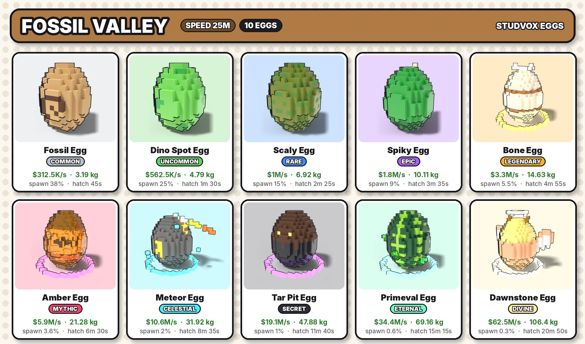

| Uovo | Rarità | Rendita base | Peso base | Spawn | Schiusa | Spec |
|---|---|---|---|---|---|---|
| Fossil Egg | Common | $312.5K/s | 3.19 kg | 38% | 45s | [fossil_egg.py](../../models/eggs/fossil/fossil_egg.py) |
| Dino Spot Egg | Uncommon | $562.5K/s | 4.79 kg | 25% | 1m 30s | [dino_spot_egg.py](../../models/eggs/fossil/dino_spot_egg.py) |
| Scaly Egg | Rare | $1M/s | 6.92 kg | 15% | 2m 25s | [scaly_egg.py](../../models/eggs/fossil/scaly_egg.py) |
| Spiky Egg | Epic | $1.8M/s | 10.11 kg | 9% | 3m 35s | [spiky_egg.py](../../models/eggs/fossil/spiky_egg.py) |
| Bone Egg | Legendary | $3.3M/s | 14.63 kg | 5.5% | 4m 55s | [bone_egg.py](../../models/eggs/fossil/bone_egg.py) |
| Amber Egg | Mythic | $5.9M/s | 21.28 kg | 3.6% | 6m 30s | [amber_egg.py](../../models/eggs/fossil/amber_egg.py) |
| Meteor Egg | Celestial | $10.6M/s | 31.92 kg | 2% | 8m 35s | [meteor_egg.py](../../models/eggs/fossil/meteor_egg.py) |
| Tar Pit Egg | Secret | $19.1M/s | 47.88 kg | 1% | 11m 40s | [tar_pit_egg.py](../../models/eggs/fossil/tar_pit_egg.py) |
| Primeval Egg | Eternal | $34.4M/s | 69.16 kg | 0.6% | 15m 15s | [primeval_egg.py](../../models/eggs/fossil/primeval_egg.py) |
| Dawnstone Egg | Divine | $62.5M/s | 106.4 kg | 0.3% | 20m 50s | [dawnstone_egg.py](../../models/eggs/fossil/dawnstone_egg.py) |

## Sugar Isles · velocità 125M

| Uovo | Rarità | Rendita base | Peso base | Spawn | Schiusa | Spec |
|---|---|---|---|---|---|---|
| Gumdrop Egg | Common | $1.6M/s | 3.67 kg | 38% | 50s | [gumdrop_egg.py](../../models/eggs/candy/gumdrop_egg.py) |
| Sprinkle Egg | Uncommon | $2.8M/s | 5.51 kg | 25% | 1m 40s | [sprinkle_egg.py](../../models/eggs/candy/sprinkle_egg.py) |
| Lollipop Egg | Rare | $5M/s | 7.95 kg | 15% | 2m 40s | [lollipop_egg.py](../../models/eggs/candy/lollipop_egg.py) |
| Cupcake Egg | Epic | $9.1M/s | 11.62 kg | 9% | 3m 55s | [cupcake_egg.py](../../models/eggs/candy/cupcake_egg.py) |
| Candy Cane Egg | Legendary | $16.4M/s | 16.82 kg | 5.5% | 5m 20s | [candy_cane_egg.py](../../models/eggs/candy/candy_cane_egg.py) |
| Chocolate Egg | Mythic | $29.7M/s | 24.47 kg | 3.6% | 7m | [chocolate_egg.py](../../models/eggs/candy/chocolate_egg.py) |
| Sugar Swirl Egg | Celestial | $53.1M/s | 36.71 kg | 2% | 9m 10s | [sugar_swirl_egg.py](../../models/eggs/candy/sugar_swirl_egg.py) |
| Sour Egg | Secret | $95.3M/s | 55.06 kg | 1% | 12m 20s | [sour_egg.py](../../models/eggs/candy/sour_egg.py) |
| Sugar Crystal Egg | Eternal | $171.9M/s | 79.53 kg | 0.6% | 16m | [sugar_crystal_egg.py](../../models/eggs/candy/sugar_crystal_egg.py) |
| Sweet Crown Egg | Divine | $312.5M/s | 122.36 kg | 0.3% | 21m 40s | [sweet_crown_egg.py](../../models/eggs/candy/sweet_crown_egg.py) |

## Clockwork Works · velocità 600M

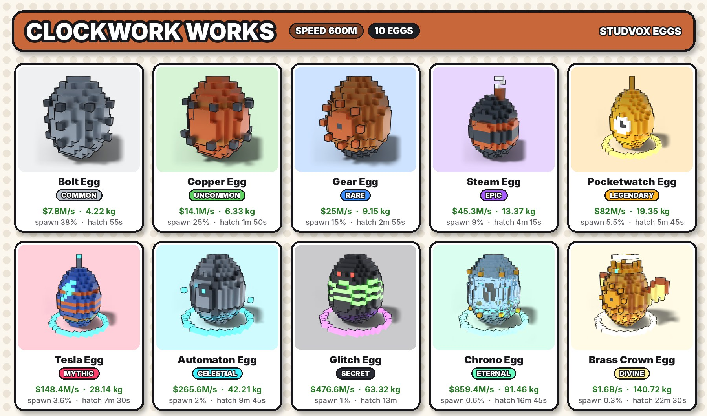

| Uovo | Rarità | Rendita base | Peso base | Spawn | Schiusa | Spec |
|---|---|---|---|---|---|---|
| Bolt Egg | Common | $7.8M/s | 4.22 kg | 38% | 55s | [bolt_egg.py](../../models/eggs/clockwork/bolt_egg.py) |
| Copper Egg | Uncommon | $14.1M/s | 6.33 kg | 25% | 1m 50s | [copper_egg.py](../../models/eggs/clockwork/copper_egg.py) |
| Gear Egg | Rare | $25M/s | 9.15 kg | 15% | 2m 55s | [gear_egg.py](../../models/eggs/clockwork/gear_egg.py) |
| Steam Egg | Epic | $45.3M/s | 13.37 kg | 9% | 4m 15s | [steam_egg.py](../../models/eggs/clockwork/steam_egg.py) |
| Pocketwatch Egg | Legendary | $82M/s | 19.35 kg | 5.5% | 5m 45s | [pocketwatch_egg.py](../../models/eggs/clockwork/pocketwatch_egg.py) |
| Tesla Egg | Mythic | $148.4M/s | 28.14 kg | 3.6% | 7m 30s | [tesla_egg.py](../../models/eggs/clockwork/tesla_egg.py) |
| Automaton Egg | Celestial | $265.6M/s | 42.21 kg | 2% | 9m 45s | [automaton_egg.py](../../models/eggs/clockwork/automaton_egg.py) |
| Glitch Egg | Secret | $476.6M/s | 63.32 kg | 1% | 13m | [glitch_egg.py](../../models/eggs/clockwork/glitch_egg.py) |
| Chrono Egg | Eternal | $859.4M/s | 91.46 kg | 0.6% | 16m 45s | [chrono_egg.py](../../models/eggs/clockwork/chrono_egg.py) |
| Brass Crown Egg | Divine | $1.6B/s | 140.72 kg | 0.3% | 22m 30s | [brass_crown_egg.py](../../models/eggs/clockwork/brass_crown_egg.py) |

## Haunted Hollow · velocità 3B

| Uovo | Rarità | Rendita base | Peso base | Spawn | Schiusa | Spec |
|---|---|---|---|---|---|---|
| Pumpkin Egg | Common | $39.1M/s | 4.85 kg | 38% | 1m | [pumpkin_egg.py](../../models/eggs/haunted/pumpkin_egg.py) |
| Candle Egg | Uncommon | $70.3M/s | 7.28 kg | 25% | 2m | [candle_egg.py](../../models/eggs/haunted/candle_egg.py) |
| Cobweb Egg | Rare | $125M/s | 10.52 kg | 15% | 3m 10s | [cobweb_egg.py](../../models/eggs/haunted/cobweb_egg.py) |
| Batwing Egg | Epic | $226.6M/s | 15.37 kg | 9% | 4m 35s | [batwing_egg.py](../../models/eggs/haunted/batwing_egg.py) |
| Ghostly Egg | Legendary | $410.2M/s | 22.25 kg | 5.5% | 6m 10s | [ghostly_egg.py](../../models/eggs/haunted/ghostly_egg.py) |
| Cursed Egg | Mythic | $742.2M/s | 32.36 kg | 3.6% | 8m | [cursed_egg.py](../../models/eggs/haunted/cursed_egg.py) |
| Witch Hat Egg | Celestial | $1.3B/s | 48.55 kg | 2% | 10m 20s | [witch_hat_egg.py](../../models/eggs/haunted/witch_hat_egg.py) |
| Shadow Eye Egg | Secret | $2.4B/s | 72.82 kg | 1% | 13m 40s | [shadow_eye_egg.py](../../models/eggs/haunted/shadow_eye_egg.py) |
| Soul Lantern Egg | Eternal | $4.3B/s | 105.18 kg | 0.6% | 17m 30s | [soul_lantern_egg.py](../../models/eggs/haunted/soul_lantern_egg.py) |
| Wraith Crown Egg | Divine | $7.8B/s | 161.82 kg | 0.3% | 23m 20s | [wraith_crown_egg.py](../../models/eggs/haunted/wraith_crown_egg.py) |

## Blossom Hills · velocità 15B

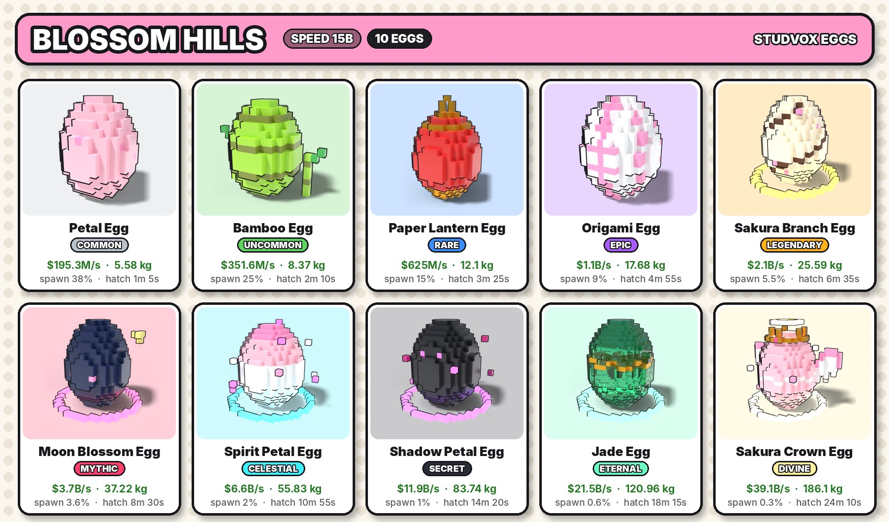

| Uovo | Rarità | Rendita base | Peso base | Spawn | Schiusa | Spec |
|---|---|---|---|---|---|---|
| Petal Egg | Common | $195.3M/s | 5.58 kg | 38% | 1m 5s | [petal_egg.py](../../models/eggs/blossom/petal_egg.py) |
| Bamboo Egg | Uncommon | $351.6M/s | 8.37 kg | 25% | 2m 10s | [bamboo_egg.py](../../models/eggs/blossom/bamboo_egg.py) |
| Paper Lantern Egg | Rare | $625M/s | 12.1 kg | 15% | 3m 25s | [paper_lantern_egg.py](../../models/eggs/blossom/paper_lantern_egg.py) |
| Origami Egg | Epic | $1.1B/s | 17.68 kg | 9% | 4m 55s | [origami_egg.py](../../models/eggs/blossom/origami_egg.py) |
| Sakura Branch Egg | Legendary | $2.1B/s | 25.59 kg | 5.5% | 6m 35s | [sakura_branch_egg.py](../../models/eggs/blossom/sakura_branch_egg.py) |
| Moon Blossom Egg | Mythic | $3.7B/s | 37.22 kg | 3.6% | 8m 30s | [moon_blossom_egg.py](../../models/eggs/blossom/moon_blossom_egg.py) |
| Spirit Petal Egg | Celestial | $6.6B/s | 55.83 kg | 2% | 10m 55s | [spirit_petal_egg.py](../../models/eggs/blossom/spirit_petal_egg.py) |
| Shadow Petal Egg | Secret | $11.9B/s | 83.74 kg | 1% | 14m 20s | [shadow_petal_egg.py](../../models/eggs/blossom/shadow_petal_egg.py) |
| Jade Egg | Eternal | $21.5B/s | 120.96 kg | 0.6% | 18m 15s | [jade_egg.py](../../models/eggs/blossom/jade_egg.py) |
| Sakura Crown Egg | Divine | $39.1B/s | 186.1 kg | 0.3% | 24m 10s | [sakura_crown_egg.py](../../models/eggs/blossom/sakura_crown_egg.py) |

## Starlight Rim · velocità 75B

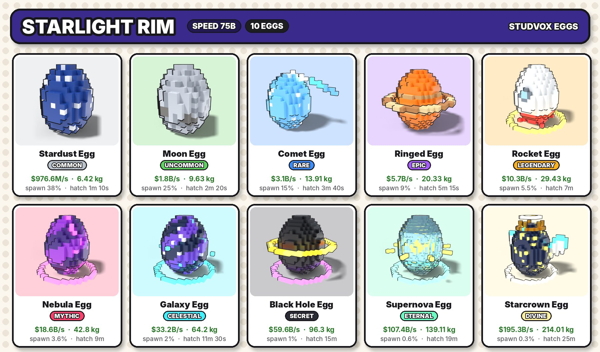

| Uovo | Rarità | Rendita base | Peso base | Spawn | Schiusa | Spec |
|---|---|---|---|---|---|---|
| Stardust Egg | Common | $976.6M/s | 6.42 kg | 38% | 1m 10s | [stardust_egg.py](../../models/eggs/starlight/stardust_egg.py) |
| Moon Egg | Uncommon | $1.8B/s | 9.63 kg | 25% | 2m 20s | [moon_egg.py](../../models/eggs/starlight/moon_egg.py) |
| Comet Egg | Rare | $3.1B/s | 13.91 kg | 15% | 3m 40s | [comet_egg.py](../../models/eggs/starlight/comet_egg.py) |
| Ringed Egg | Epic | $5.7B/s | 20.33 kg | 9% | 5m 15s | [ringed_egg.py](../../models/eggs/starlight/ringed_egg.py) |
| Rocket Egg | Legendary | $10.3B/s | 29.43 kg | 5.5% | 7m | [rocket_egg.py](../../models/eggs/starlight/rocket_egg.py) |
| Nebula Egg | Mythic | $18.6B/s | 42.8 kg | 3.6% | 9m | [nebula_egg.py](../../models/eggs/starlight/nebula_egg.py) |
| Galaxy Egg | Celestial | $33.2B/s | 64.2 kg | 2% | 11m 30s | [galaxy_egg.py](../../models/eggs/starlight/galaxy_egg.py) |
| Black Hole Egg | Secret | $59.6B/s | 96.3 kg | 1% | 15m | [black_hole_egg.py](../../models/eggs/starlight/black_hole_egg.py) |
| Supernova Egg | Eternal | $107.4B/s | 139.11 kg | 0.6% | 19m | [supernova_egg.py](../../models/eggs/starlight/supernova_egg.py) |
| Starcrown Egg | Divine | $195.3B/s | 214.01 kg | 0.3% | 25m | [starcrown_egg.py](../../models/eggs/starlight/starcrown_egg.py) |

## Sky Citadel · velocità 400B

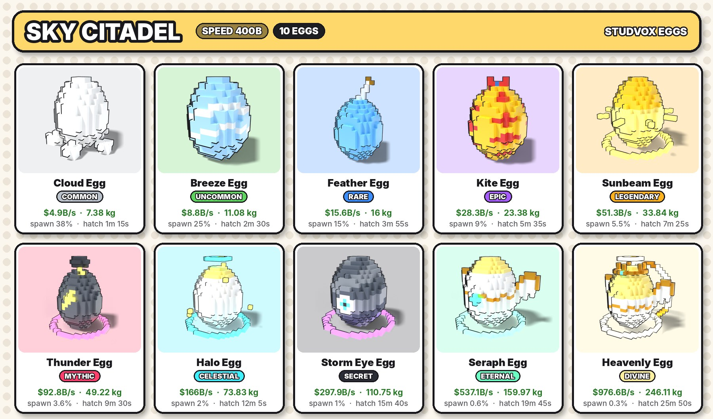

| Uovo | Rarità | Rendita base | Peso base | Spawn | Schiusa | Spec |
|---|---|---|---|---|---|---|
| Cloud Egg | Common | $4.9B/s | 7.38 kg | 38% | 1m 15s | [cloud_egg.py](../../models/eggs/sky/cloud_egg.py) |
| Breeze Egg | Uncommon | $8.8B/s | 11.08 kg | 25% | 2m 30s | [breeze_egg.py](../../models/eggs/sky/breeze_egg.py) |
| Feather Egg | Rare | $15.6B/s | 16 kg | 15% | 3m 55s | [feather_egg.py](../../models/eggs/sky/feather_egg.py) |
| Kite Egg | Epic | $28.3B/s | 23.38 kg | 9% | 5m 35s | [kite_egg.py](../../models/eggs/sky/kite_egg.py) |
| Sunbeam Egg | Legendary | $51.3B/s | 33.84 kg | 5.5% | 7m 25s | [sunbeam_egg.py](../../models/eggs/sky/sunbeam_egg.py) |
| Thunder Egg | Mythic | $92.8B/s | 49.22 kg | 3.6% | 9m 30s | [thunder_egg.py](../../models/eggs/sky/thunder_egg.py) |
| Halo Egg | Celestial | $166B/s | 73.83 kg | 2% | 12m 5s | [halo_egg.py](../../models/eggs/sky/halo_egg.py) |
| Storm Eye Egg | Secret | $297.9B/s | 110.75 kg | 1% | 15m 40s | [storm_eye_egg.py](../../models/eggs/sky/storm_eye_egg.py) |
| Seraph Egg | Eternal | $537.1B/s | 159.97 kg | 0.6% | 19m 45s | [seraph_egg.py](../../models/eggs/sky/seraph_egg.py) |
| Heavenly Egg | Divine | $976.6B/s | 246.11 kg | 0.3% | 25m 50s | [heavenly_egg.py](../../models/eggs/sky/heavenly_egg.py) |
